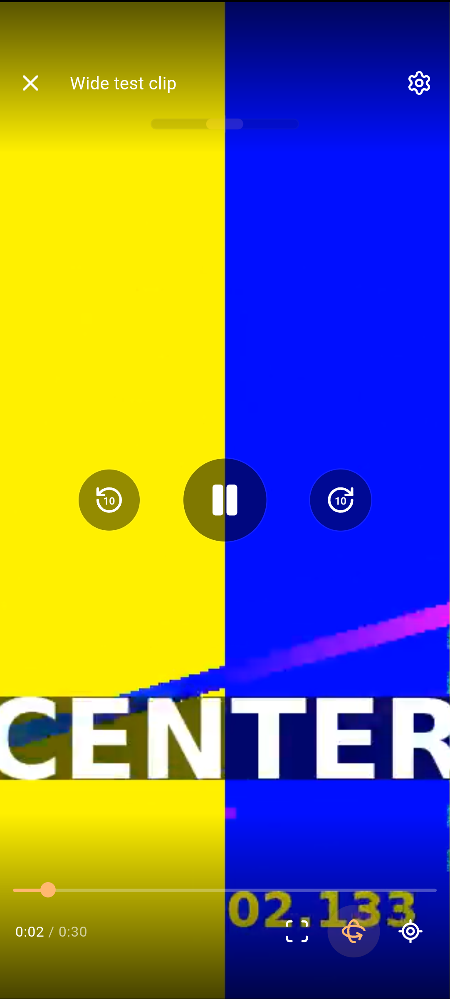
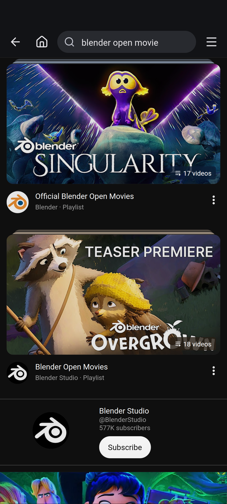
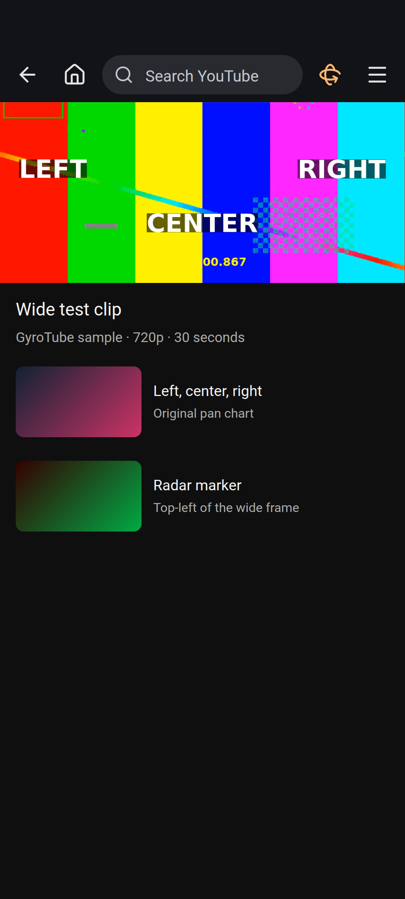
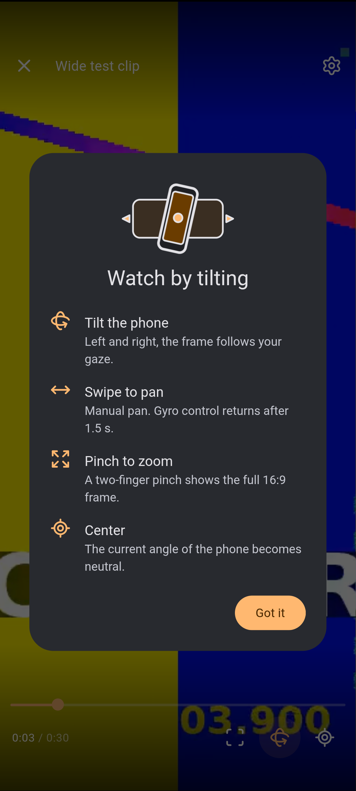
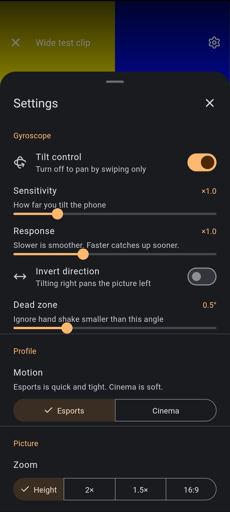
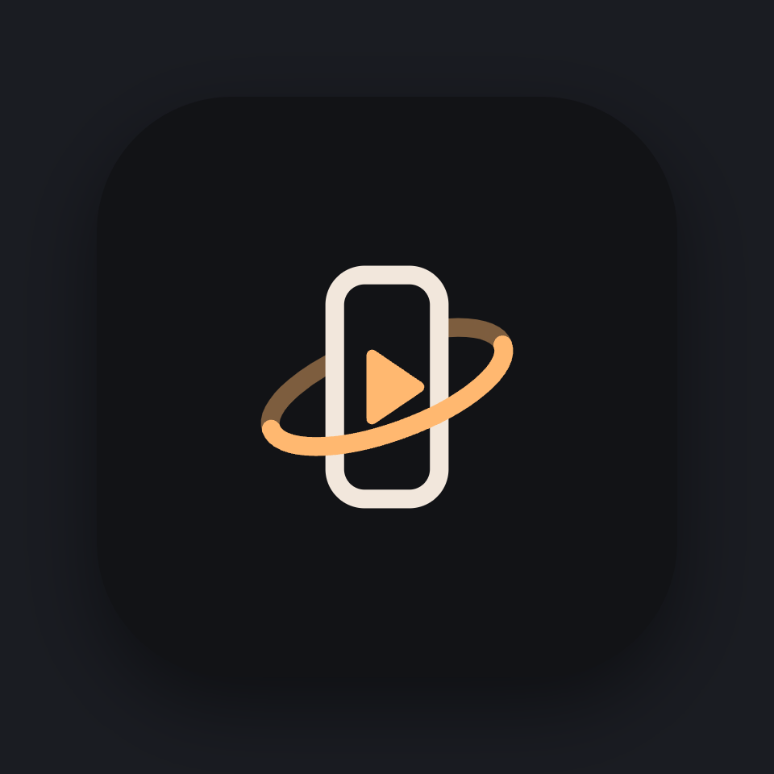
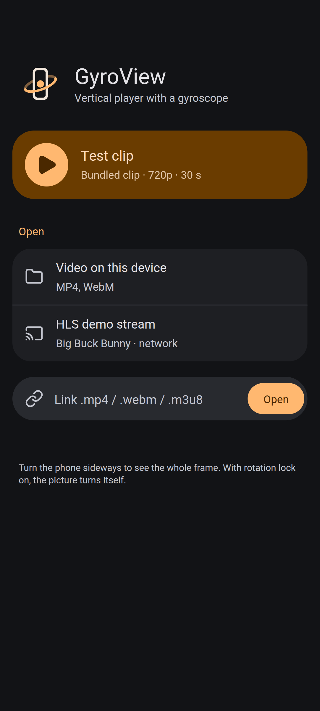
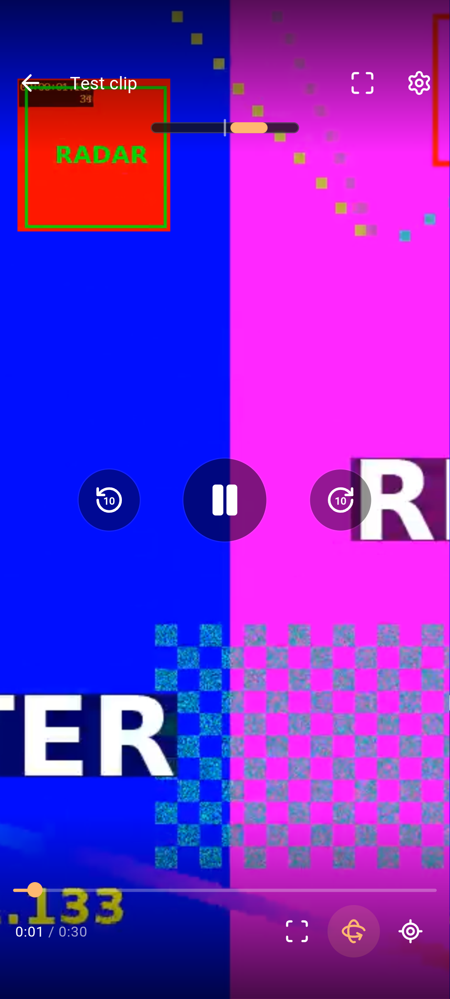
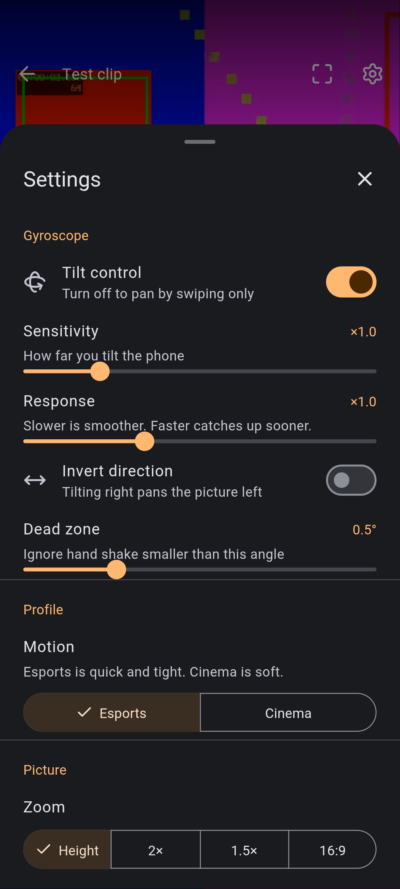
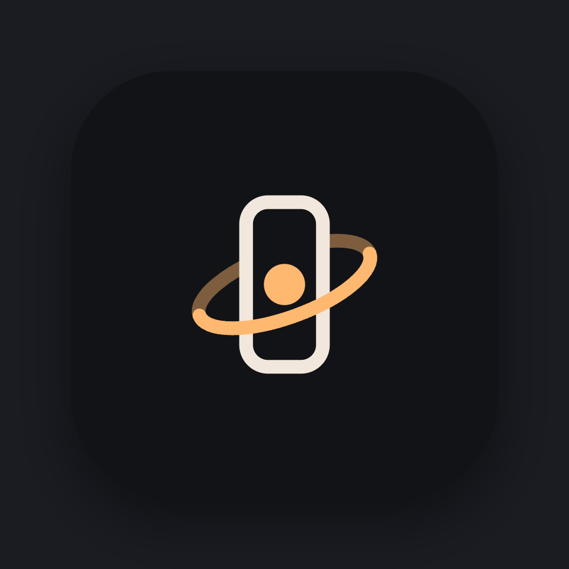

# GyroTube

**A YouTube client for Android. In portrait, 16:9 video fills the screen height, and you choose the part of the frame by tilting the phone.**

It also blocks ads and draws its own Material 3 interface. GyroTube 1.4, minSdk 24.

[](LICENSE)
[](https://developer.android.com/)
[](android-gyrotube/AndroidManifest.xml)

Hold the phone in portrait and the picture is cropped to the screen height (**Fit-Height**). Tilting left and right slides that window across the wide frame. Turn the phone to landscape, or hold it sideways with rotation locked, and the whole frame is shown. The player watches the auto-rotate setting, so a locked sideways pose and a system rotation each show the frame once.

<p align="center"></p>

## Features

- Portrait Fit-Height playback of YouTube video, with landscape and rotation-lock showing the full frame
- Velocity-adaptive gyroscope: dead zone, mild S-curve, and smoothing that tightens when you move faster
- Motion profiles **Esports** (fast, tight) and **Cinema** (soft)
- Zoom **Height**, **2×**, **1.5×**, and **16:9**, plus pinch zoom
- Drag to pan; gyro control returns about 1.5 s after you lift your finger
- Calibration (“this angle is center”) and a minimap of the window inside the frame
- Built-in ad blocking (network requests, in-player ads, and promo cards) with auto-skip
- Material 3 dark UI: search bar, library, history, settings, safe-area insets, screen wake lock
- Sign-in that stays inside this app. See [Account](#account)

## Screenshots

Phone-sized captures (412×915 CSS pixels). Safe-area insets are the app’s own `--sat` / `--sab` padding, the same values the Android shell pushes for a notch and a gesture bar.

The search page is live `m.youtube.com` with GyroTube’s bar injected. YouTube refused to start playback in this browser (“Sign in to confirm you’re not a bot”), so the watch page, gyro player, settings, and first-run card are the same UI on a local stand-in that plays the original chart in [`web/sample.mp4`](web/sample.mp4).

<table>
<tr>
<td align="center" width="25%"><br><b>Search</b></td>
<td align="center" width="25%"><br><b>Watch</b></td>
<td align="center" width="25%"><br><b>Portrait player</b></td>
<td align="center" width="25%"><br><b>First run</b></td>
</tr>
<tr>
<td align="center"><br><b>Settings</b></td>
<td align="center"><br><b>Launcher</b></td>
<td></td>
<td></td>
</tr>
</table>

## Account

GyroTube has no account of its own. The WebView keeps cookies for `m.youtube.com`, separate from the YouTube app and from Chrome on the phone. Signed out, recommendations are YouTube’s anonymous ones, and Subscriptions is only a sign-in prompt, so the menu hides **Subscriptions** and **Account** and shows **Sign in to YouTube**.

That action opens Google’s normal sign-in inside the WebView:

`https://accounts.google.com/ServiceLogin?service=youtube&hl=en&continue=https://m.youtube.com/`

The activity keeps its mobile Chrome user agent, and the ad filter does not touch `accounts.google.com`, `myaccount.google.com`, or `accounts.youtube.com`.

Signed in (a `SAPISID` or `LOGIN_INFO` cookie, also checked from the page), **Subscriptions** and **Account** come back. Settings then offers **Sign out**, which expires the cookies for `youtube.com` and `google.com` and returns to the mobile home page. Settings always includes: “Your sign-in stays on this device inside GyroTube; the app never sees your password.”

## Install

GyroTube is not on Play. Copy `GyroTube.apk` to the phone and open it, or:

```bash
adb install -r android-gyrotube/dist/GyroTube.apk
```

Android asks you to allow that source (Settings → Apps → Special app access → Install unknown apps). A gyroscope is optional; drag still pans the frame. The companion player installs the same way from `android-gyroview/dist/GyroView.apk`.

## Build

JDK 17 or newer, Android SDK **build-tools 35.0.0**, and **platforms;android-34**. Both apps build with aapt2, javac, d8, zipalign, and apksigner. Current versions: GyroTube **1.4** (versionCode 5), GyroView **1.5** (versionCode 6).

```bash
export ANDROID_HOME="$HOME/android-sdk"   # ANDROID_SDK_ROOT is also accepted
sdkmanager "platforms;android-34" "build-tools;35.0.0"

(cd android-gyrotube && ./build.sh)       # android-gyrotube/dist/GyroTube.apk
(cd android-gyroview && ./build.sh)       # android-gyroview/dist/GyroView.apk
```

Pass another output path as the first argument if you want the APK elsewhere. GitHub Actions builds both and uploads them as the **GyroTube** artifact, GyroTube’s APK first. CI signs with a keystore that exists only on that runner.

### Signing

Signing passwords come from the environment:

| Variable | Meaning |
| --- | --- |
| `KEYSTORE` | Path to your keystore. If unset, a debug keystore is generated. |
| `KEYSTORE_PASS` | Store password. Required when `KEYSTORE` is set. |
| `KEY_ALIAS` | Key alias. Required when `KEYSTORE` is set. |
| `KEY_PASS` | Key password. Defaults to `KEYSTORE_PASS`. |

```bash
export KEYSTORE="$HOME/keys/gyrotube.keystore"
export KEYSTORE_PASS='your store password'
export KEY_ALIAS='upload'
export KEY_PASS='your key password'   # optional
```

`apksigner` receives the passwords through its `env:` provider. A PKCS12 keystore (what current `keytool` writes) uses the store password for the key too, so leave `KEY_PASS` unset or set it to the same value. A JKS keystore can use a different `KEY_PASS`.

If `KEYSTORE` is unset, the first build writes `local-debug.keystore` in that app directory. The store password, key password, and alias are the throwaway local values `local-debug` / `local-debug` / `localdebug`, with a certificate subject of `CN=Local Debug, OU=Throwaway, O=Local Only`. That file is gitignored. Keeping it lets the next local build install as an update. Treat it as a local debug identity only. Delete it and the next APK has a new signature, so Android asks for an uninstall before it will install.

Do not commit `*.keystore`, `*.jks`, or a password.

## How the pan is computed

Tilt is measured from a calibrated center. Δγ is a blend of device roll and gamma (degrees). Sensitivity `s_ens` scales the range, the dead zone `z` defaults to 0.5° (clamped to 0°–3°), and the curve exponent `p` is 1.05.

Inside the dead zone the window stays put:

$$
|\Delta\gamma| \le z \Rightarrow X = 0.5
$$

Outside it, the remaining angle is normalized and run through a mild S-curve. With no dead zone this is

$$
X = 0.5 + \operatorname{sign}(\Delta\gamma) \cdot \left(\frac{|\Delta\gamma|}{\gamma_{\max}}\right)^{p} \cdot 0.5
$$

The code subtracts the dead zone first, then clamps:

$$
t = \operatorname{clamp}\!\left(\frac{|\Delta\gamma| - z}{\gamma_{\max} - z},\, 0,\, 1\right)
$$

$$
X = \operatorname{clamp}\!\left(0.5 + \operatorname{sign}(\Delta\gamma)\, t^{p}\, 0.5,\, 0,\, 1\right)
$$

$$
\gamma_{\max} = 22° / s_{\mathrm{ens}}
$$

`X = 0` is the left edge of the frame, `X = 1` the right edge, `X = 0.5` the center. Preset sensitivities are ×1, ×1.5, and ×2.

That target is not applied raw. Each frame lerps toward it with a time constant that grows with tilt speed `ω` (degrees per second), so a slow drift stays smooth and a flick catches up. `s_speed` is the response slider (1 is neutral):

$$
\lambda = \big(\lambda_{\min} + (\lambda_{\max} - \lambda_{\min})\,\mathrm{smoothstep}(5,\, 120,\, |\omega|)\big) \cdot s_{\mathrm{speed}}
$$

$$
\mathrm{smoothstep}(a, b, x) = u^{2}(3 - 2u), \quad u = \operatorname{clamp}\!\left(\frac{x - a}{b - a},\, 0,\, 1\right)
$$

$$
X \leftarrow X + (X^{\star} - X)\,\big(1 - e^{-\lambda \Delta t}\big)
$$

| Profile | λ min | λ max | Feel |
| --- | --- | --- | --- |
| Esports | 5 | 30 | Fast and tight |
| Cinema | 2.5 | 12 | Soft |

A short look-ahead (0.07 s Esports, 0.035 s Cinema, capped at ±6°) is added to Δγ while the phone is actually moving, so a fast swing arrives a little early and a still phone stays put.

A finger drag sets `X` directly (λ = 35 while the finger is down) and pauses the gyro. About 1.5 s after release the current angle is rebased onto the current `X`, and the gyro takes over again without a jump.

## Architecture

```text
tilt
 ├─ browser: deviceorientation (needs a secure context)
 └─ Android: GAME_ROTATION_VECTOR, polled once a frame as "seq,gx,gy,gz"
        │
        ▼
     gvkit.js          dead zone, S-curve, smoothing, Material 3 UI
        │
        ├─ GyroTube    CSS translate / scale on YouTube's own <video>
        └─ GyroView    WebGL. The visible slice is a UV window on the frame
```

**GyroTube** (`space.gyroview.youtube`) loads `m.youtube.com`. At build time `gvkit.js` and `assets/gyrotube.js` are concatenated and injected at document start. The activity blocks a fixed set of ad and tracker hosts, presents a normal Chrome user agent, and forwards `youtube.com` / `youtu.be` view intents into the WebView. Sign-in hosts stay in the WebView. Anything else opens outside the app.

`gvkit/gvkit.js` is the source of truth. `web/gvkit.js` is a copy so the GyroView folder works with a static server. Both Android builds read `gvkit/gvkit.js` directly.

## Companion: GyroView player

[GyroView](web/) 1.5 is the standalone player on the same GVKit core. It opens a local file, an HLS URL, or the bundled 30-second 720p chart, and draws the frame with WebGL. In the Esports profile at Fit-Height it can pin a small copy of the top-left of the frame (the radar HUD) on top of the video. The Android app (`space.gyroview.player`) is a WebView shell that serves those files from `https://appassets.androidplatform.net/`, with range requests so the chart can seek.

<table>
<tr>
<td align="center"><br><b>Start</b></td>
<td align="center"><br><b>Portrait, radar</b></td>
<td align="center"><br><b>Settings</b></td>
<td align="center"><br><b>Launcher</b></td>
</tr>
</table>

On the same computer, localhost is a secure context, so orientation events work:

```bash
cd web
python3 -m http.server 8080
# http://localhost:8080
```

On a phone, `deviceorientation` and the screen wake lock are available when the page is served over HTTPS. iOS also needs a tap; the start screen requests permission inside that gesture.

The bundled clip is an original color-bar chart (LEFT / CENTER / RIGHT, plus radar and kill-feed markers). The HLS button streams *Big Buck Bunny* from a public test server; the film stays on that server. See [THIRD_PARTY_NOTICES.md](THIRD_PARTY_NOTICES.md).

## Repository layout

```text
android-gyrotube/       GyroTube WebView app, injection script, AndroidX jars
android-gyroview/       GyroView WebView app and build.sh
gvkit/                  shared gyro core and Material 3 UI, plus the Lucide notice
web/                    GyroView static player and sample.mp4
screenshots/            README images
scripts/sign-apk.sh     shared signer (env vars, or a local debug keystore)
.github/workflows/      APK build, GyroTube artifact first
```

## Roadmap

- One copy of `gvkit.js`, instead of a checked-in duplicate under `web/`
- Picture-in-picture
- A documented path for a stable sideload key, still without committing that key

## Contributing

Issues and pull requests are welcome.

- Do not commit keystores, APKs, `build/`, or `dist/`.
- Gyro behavior belongs in `gvkit/gvkit.js`. Copy the result to `web/gvkit.js` so the static player matches. The Android builds already read `gvkit/`.
- UI copy is English.
- Sensor, inset, and YouTube-injection changes need a device. Each Android app builds with its own `build.sh`.

## License and notices

Code in this repository is [MIT](LICENSE), copyright 2026 who1900. Icons in GVKit are Lucide (ISC), some of them derived from Feather (MIT). The AndroidX jars are Apache-2.0. Details are in [THIRD_PARTY_NOTICES.md](THIRD_PARTY_NOTICES.md).

## Disclaimer

GyroTube is an unofficial client for personal use. It is not affiliated with, or endorsed by, YouTube or Google.

Ad blocking, including hiding, muting, and skipping ads, may violate the YouTube Terms of Service. Use it at your own risk. YouTube’s pages are loaded from the network when the app runs. This repository does not include any YouTube video.
