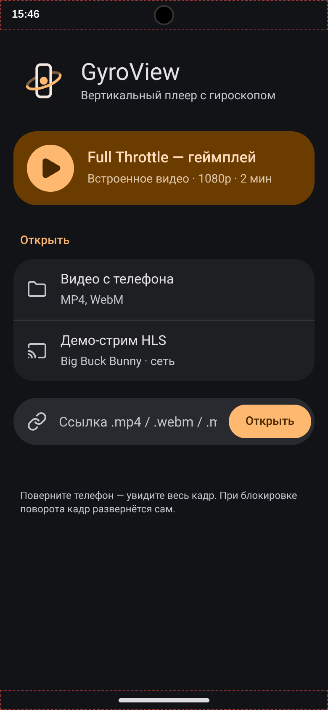
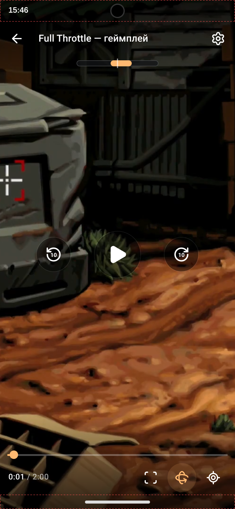
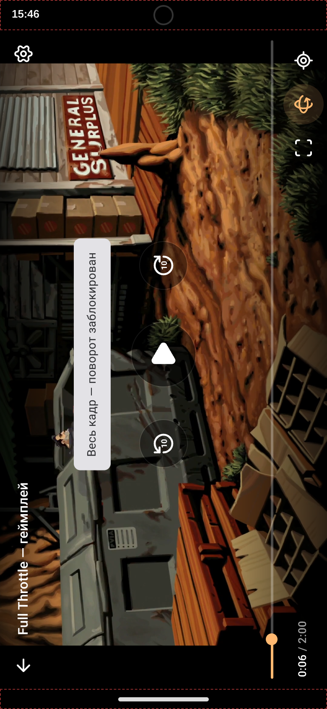
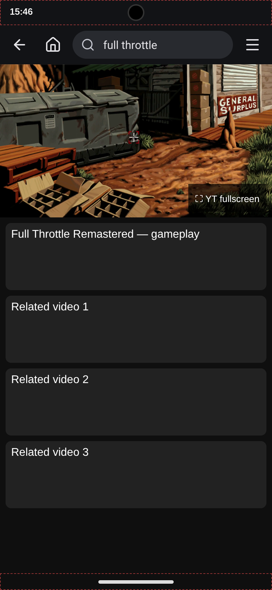
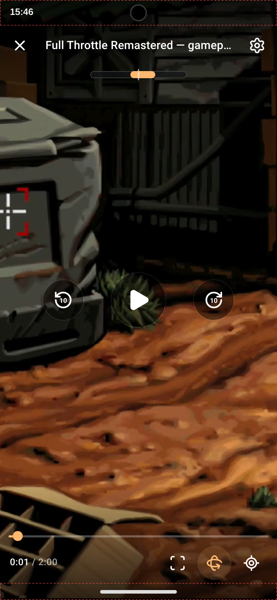
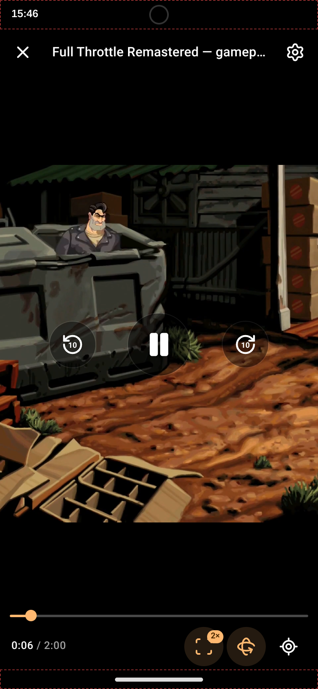
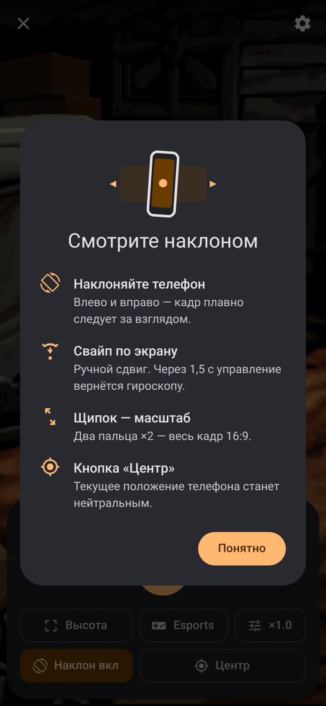
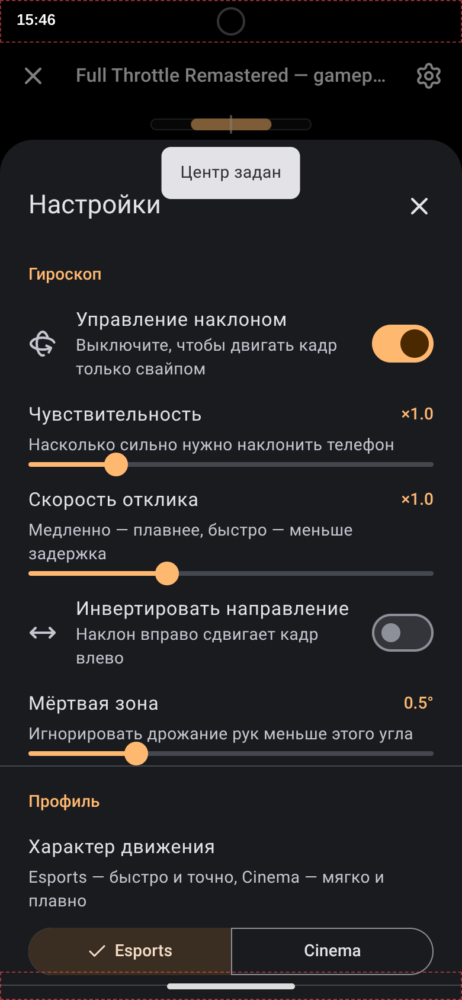
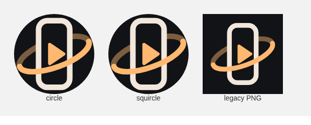

# GyroTube

**Tilt the phone. The picture pans with you.**

GyroView is a vertical player that treats portrait as a window onto a wider frame. GyroTube is that same window, pointed at YouTube.

[](LICENSE)
[](https://developer.android.com/)
[](android-gyroview/AndroidManifest.xml)

Hold the phone in portrait and a 16:9 frame is cropped to the screen height (**Fit-Height**). Tilting left and right slides that window across the frame — a gyroscope magic window. Turn the phone to landscape, or hold it sideways with rotation locked, and the whole frame is shown. The player watches the auto-rotate setting, so a locked sideways pose and a system rotation each show the frame once.

The in-app UI is currently Russian.

## Features

Shared by GyroView and GyroTube:

- Velocity-adaptive gyroscope with a dead zone and a mild S-curve
- Motion profiles **Esports** (fast, tight) and **Cinema** (soft)
- Zoom levels **Height**, **2×**, **1.5×**, and **16:9**, plus pinch zoom
- One-finger drag overrides the gyro and hands control back after a moment
- Calibration (“this angle is center”), and a minimap of where the window sits in the frame
- Screen wake lock while video is playing
- Safe-area insets for the notch and the gesture bar
- Material 3 dark UI

GyroView adds a pinned radar HUD (a small copy of the top-left of the frame) in the Esports profile at Fit-Height.

GyroTube opens [m.youtube.com](https://m.youtube.com/) inside the app, replaces the browser chrome with its own bar (search, home, library, account), and blocks a set of ad and tracker requests. Ads that still start are muted and skipped. See the [disclaimer](#disclaimer).

## Screenshots

Dashed red strips in these captures are the test rig's simulated notch and gesture bar. The pictures were shot against a widescreen clip so the crop is easy to see. The only video file in this repository is the original 30-second test chart, [`web/sample.mp4`](web/sample.mp4).

<table>
<tr>
<td align="center" width="25%"><br><b>GyroView</b><br>Start screen</td>
<td align="center" width="25%"><br><b>GyroView</b><br>Portrait, radar HUD</td>
<td align="center" width="25%"><br><b>GyroView</b><br>Rotation lock, full frame</td>
<td align="center" width="25%"><br><b>GyroTube</b><br>Browse bar</td>
</tr>
<tr>
<td align="center"><br><b>GyroTube</b><br>Portrait player</td>
<td align="center"><br><b>GyroTube</b><br>2× zoom, controls up</td>
<td align="center"><br><b>GyroTube</b><br>First-run card</td>
<td align="center"><br><b>GyroTube</b><br>Settings</td>
</tr>
<tr>
<td align="center" colspan="2"><br><b>GyroView</b> launcher masks</td>
<td align="center" colspan="2"><br><b>GyroTube</b> launcher masks</td>
</tr>
</table>

## How the pan is computed

Tilt is measured from a calibrated center. Δγ is a blend of device roll and gamma (degrees). Sensitivity `s_ens` scales the range, the dead zone `z` defaults to 0.5° (clamped to 0°–3°), and the curve exponent `p` is 1.05.

Inside the dead zone the window stays put:

$$
|\Delta\gamma| \le z \Rightarrow X = 0.5
$$

Outside it, the remaining angle is normalized and run through a mild S-curve. With no dead zone this is

$$
X = 0.5 + \operatorname{sign}(\Delta\gamma) \cdot \left(\frac{|\Delta\gamma|}{\gamma_{\max}}\right)^{p} \cdot 0.5
$$

The code subtracts the dead zone first, then clamps:

$$
t = \operatorname{clamp}\!\left(\frac{|\Delta\gamma| - z}{\gamma_{\max} - z},\, 0,\, 1\right)
$$

$$
X = \operatorname{clamp}\!\left(0.5 + \operatorname{sign}(\Delta\gamma)\, t^{p}\, 0.5,\, 0,\, 1\right)
$$

$$
\gamma_{\max} = 22° / s_{\mathrm{ens}}
$$

`X = 0` is the left edge of the frame, `X = 1` the right edge, `X = 0.5` the center. Preset sensitivities are ×1, ×1.5, and ×2.

That target is not applied raw. Each frame lerps toward it with a time constant that grows with tilt speed `ω` (degrees per second), so a slow drift is smooth and a flick catches up. `s_speed` is the response slider (1 is neutral):

$$
\lambda = \big(\lambda_{\min} + (\lambda_{\max} - \lambda_{\min})\,\mathrm{smoothstep}(5,\, 120,\, |\omega|)\big) \cdot s_{\mathrm{speed}}
$$

$$
\mathrm{smoothstep}(a, b, x) = u^{2}(3 - 2u), \quad u = \operatorname{clamp}\!\left(\frac{x - a}{b - a},\, 0,\, 1\right)
$$

$$
X \leftarrow X + (X^{\star} - X)\,\big(1 - e^{-\lambda \Delta t}\big)
$$

| Profile | λ min | λ max | Feel |
| --- | --- | --- | --- |
| Esports | 5 | 30 | Fast and tight |
| Cinema | 2.5 | 12 | Soft |

A short look-ahead (0.07 s Esports, 0.035 s Cinema, capped at ±6°) is added to Δγ while the phone is actually moving, so a fast swing arrives a little early and a still phone does not drift.

A finger drag sets `X` directly (λ = 35 while the finger is down) and pauses the gyro. About 1.5 s after release the current angle is rebased onto the current `X`, and the gyro takes over again without a jump.

## Architecture

```text
tilt
 ├─ browser: deviceorientation (needs a secure context)
 └─ Android: GAME_ROTATION_VECTOR, polled once a frame as "seq,gx,gy,gz"
        │
        ▼
     gvkit.js          dead zone, S-curve, smoothing, Material 3 UI
        │
        ├─ GyroView    WebGL. The visible slice is a UV window on the frame.
        │              Esports Fit-Height can pin a second draw of the radar.
        └─ GyroTube    CSS translate / scale on YouTube's own <video>.
```

- **GyroView Android** (`space.gyroview.player`) is a WebView shell. It serves `web/` from `https://appassets.androidplatform.net/` so the page is a secure context (orientation, wake lock). The bundled clip is served with HTTP range requests so seeking works. Insets and the auto-rotate setting are pushed into the page.
- **GyroTube Android** (`space.gyroview.youtube`) loads `m.youtube.com`. At build time `gvkit.js` and `assets/gyrotube.js` are concatenated and injected at document start. The activity blocks a fixed set of ad and tracker hosts, presents a normal Chrome user agent, and forwards `youtube.com` / `youtu.be` view intents into the WebView. Anything that is not YouTube opens outside the app.

`gvkit/gvkit.js` is the source of truth. `web/gvkit.js` is a copy so the `web/` folder works with a static server and no build step. Both Android build scripts read `gvkit/gvkit.js` directly.

## Repository layout

```text
web/                    GyroView static player (index, style, app, gvkit, sample.mp4)
gvkit/                  shared gyro core and Material 3 UI, plus the Lucide notice
android-gyroview/       GyroView WebView app and build.sh
android-gyrotube/       GyroTube WebView app, injection script, AndroidX jars
screenshots/            README images
scripts/sign-apk.sh     shared signer (env vars, or a local debug keystore)
.github/workflows/      APK build
```

## Build

You need JDK 17 or newer, Android SDK **build-tools 35.0.0**, and **platforms;android-34**. The Android apps are built with aapt2, javac, d8, zipalign, and apksigner.

```bash
export ANDROID_HOME="$HOME/android-sdk"   # ANDROID_SDK_ROOT is also accepted
sdkmanager "platforms;android-34" "build-tools;35.0.0"

(cd android-gyroview && ./build.sh)       # android-gyroview/dist/GyroView.apk
(cd android-gyrotube && ./build.sh)       # android-gyrotube/dist/GyroTube.apk
```

Pass another output path as the first argument if you want the APK elsewhere.

### Signing

Signing passwords come from the environment:

| Variable | Meaning |
| --- | --- |
| `KEYSTORE` | Path to your keystore. If unset, a debug keystore is generated. |
| `KEYSTORE_PASS` | Store password. Required when `KEYSTORE` is set. |
| `KEY_ALIAS` | Key alias. Required when `KEYSTORE` is set. |
| `KEY_PASS` | Key password. Defaults to `KEYSTORE_PASS`. |

```bash
export KEYSTORE="$HOME/keys/gyrotube.keystore"
export KEYSTORE_PASS='your store password'
export KEY_ALIAS='upload'
export KEY_PASS='your key password'   # optional
```

`apksigner` receives the passwords through its `env:` provider. A PKCS12 keystore (what current `keytool` writes) uses the store password for the key too, so leave `KEY_PASS` unset or set it to the same value. A JKS keystore can use a different `KEY_PASS`.

If `KEYSTORE` is unset, the first build writes `local-debug.keystore` in that app directory. The store password, key password, and alias are the throwaway local values `local-debug` / `local-debug` / `localdebug`, with a certificate subject of `CN=Local Debug, OU=Throwaway, O=Local Only`. That file is gitignored. Keeping it lets the next local build install as an update. Treat it as a local debug identity only. Delete it and the next APK has a new signature, so Android asks for an uninstall before it will install. CI artifacts are signed with a keystore that exists only on that runner.

Do not commit `*.keystore`, `*.jks`, or a password.

## Install

The APKs are not from Play. Copy one to the phone and open it, or:

```bash
adb install -r android-gyroview/dist/GyroView.apk
adb install -r android-gyrotube/dist/GyroTube.apk
```

Android will ask you to allow installs from that source (Settings → Apps → Special app access → Install unknown apps, then the file manager or `adb` you are using). A gyroscope is optional; without one, drag still pans the frame.

## Web player

`web/` is a static site. On the same computer, localhost counts as a secure context, so orientation events work:

```bash
cd web
python3 -m http.server 8080
# http://localhost:8080
```

On a phone, `deviceorientation` and the screen wake lock are available when the page is served over HTTPS (a tunnel, Caddy, or any local certificate). iOS also requires a tap; the start screen requests permission inside that gesture.

The bundled clip is an original 30-second 1280×720 chart (color bars labeled LEFT / CENTER / RIGHT, plus radar and kill-feed markers) for checking the pan. The HLS button streams *Big Buck Bunny* from a public test server; the film stays on that server. See [THIRD_PARTY_NOTICES.md](THIRD_PARTY_NOTICES.md).

## Roadmap

- One copy of `gvkit.js`, instead of a checked-in duplicate under `web/`
- An English UI
- Picture-in-picture
- A documented path for a stable sideload key, still without committing that key

## Contributing

Issues and pull requests are welcome.

- Do not commit keystores, APKs, `build/`, or `dist/`.
- Behavior changes for the gyro belong in `gvkit/gvkit.js`. Copy the result to `web/gvkit.js` so the static player matches. The Android builds already read `gvkit/` themselves.
- UI strings are Russian. Keep new strings in that language unless you are doing the English pass on purpose.
- Sensor, inset, and YouTube-injection changes need a device. The Gradle-free build is `build.sh` in each Android directory.

## Disclaimer

GyroTube is an unofficial client for personal use. It is not affiliated with, or endorsed by, YouTube or Google.

Ad blocking, including hiding, muting, and skipping ads, may violate the YouTube Terms of Service. Use it at your own risk. YouTube's pages are loaded from the network when the app runs. This repository does not include any YouTube video.
